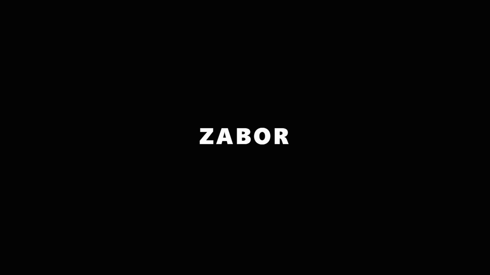

# ZABOR 

Редакция / updated: 2026-11-06.

[](https://github.com/vnkdevelop/zabor-desktop/actions/workflows/build.yml)
[](https://github.com/vnkdevelop/zabor-desktop/releases)
[](LICENSE)
[](https://www.electronjs.org/)
[](https://react.dev/)
[](https://www.typescriptlang.org/)

ZABOR - приложение для голосового общения, P2P-звонков и трансляции экрана с низкой задержкой.




## Возможности

- Голосовые каналы на базе P2P Mesh WebRTC.
- Личные сообщения и передача файлов со сквозным шифрованием.
- Система друзей, профили и статусы в реальном времени.
- Трансляция экрана или камеры.
- Нейросетевое шумоподавление DeepFilterNet 3 и RNNoise.
- Скрытые достижения и ачивки.

## Быстрый старт

Требования: [Node.js 20+](https://nodejs.org/) и npm.

```bash
git clone https://github.com/vnkdevelop/zabor-desktop.git
cd zabor-desktop && npm ci
npm run dev
```

Приложение запускается в режиме разработки через `electron-vite`.

## Стек технологий

| Область                 | Технологии                                                  |
| ----------------------- | ----------------------------------------------------------- |
| Интерфейс               | React 18, TypeScript, Tailwind CSS, Framer Motion           |
| Desktop                 | Electron 44, electron-vite, electron-builder                |
| Состояние и локализация | Zustand, i18next                                            |
| Связь                   | WebRTC, ASP.NET Core SignalR                                |
| Медиа                   | Web Audio API, WebAssembly, ONNX Runtime Web, DeepFilterNet |
| Backend                 | C# / .NET 10, SQLite, Entity Framework Core                 |

Backend не входит в этот репозиторий.

### Экспериментальная миграция на Rust

Работа ведётся через `beta/rust-migration` и её изолированные рабочие ветки. Первый клиентский Rust-модуль — voicing autocorrelation — выполняется в WASM внутри существующего AudioWorklet, с фиксированной памятью и совместимым legacy fallback. Это частичный перенос DSP, не полностью нативный клиент: React, Electron, модели и Chromium WebRTC сохранены. Перепись backend на Rust отменена владельцем; .NET backend и Go SFU остаются прежними.

Beta использует отдельный профиль и канал обновлений; импорт реального stable-профиля пока не поддержан. Состояние этапов, проверки и блокеры: [docs/migration/status.md](docs/migration/status.md).

Rust migration is experimental on the beta branch and its work branches. The first block-based voicing module runs as WASM inside the existing AudioWorklet with fixed memory and a legacy fallback; this is not a fully native shell/media client. React, Electron, models, Chromium WebRTC, .NET backend and Go SFU are retained. The owner cancelled the Rust backend rewrite. Beta uses a separate profile/update channel; importing a real stable profile is not supported yet.

Выпуск и проверки двух устройств: [docs/migration/client-beta-testing.md](docs/migration/client-beta-testing.md). `release.bat` выбирает stable на `main` и beta на `beta/rust-migration`; `release-beta.bat` принудительно выбирает beta. Они не используют автоматический `git add .`, stash/rebase или неизвестную ветку. Переход в main выполняется отдельно после явного подтверждения тестов владельцем.

### Нативный Rust-клиент: текущая разработка

В `rust/native-client` идёт полный перенос на Rust + Slint 1.18.1 (winit/femtovg), без браузера в нативном клиенте. Точка восстановления прежнего рабочего клиента — `d088795`. Добавлены формы авторизации и основная оболочка, SignalR/WebSocket, нативный libwebrtc/WASAPI, DPAPI/SQLite и шифрованный резервный текстовый чат. Полный функциональный паритет, трансляции/neural DSP, импорт и установщик/updater ещё в работе. `3.8.0-rust` — целевая версия, а не опубликованный полноценный нативный релиз.

Для разработки нужны Windows, Rust 1.92+ с MSVC toolchain и C++ Build Tools. Запуск: `cmd.exe /c native.bat`. Полная проверка окна против React: `cmd.exe /c native.bat check`; дополнительно нужны Node.js 24, установленные npm-зависимости и Python с Pillow. Она снимает 54 пары кадров, проверяет четыре DPI-масштаба, оба языка, анимации и клавиатурные действия. Команды, границы проверок и оставшиеся этапы: [native-client-status.md](docs/migration/native-client-status.md).

The `rust/native-client` branch develops a native Rust + Slint port from checkpoint `d088795`. Authentication/shell views, SignalR/WebSocket, libwebrtc/WASAPI, DPAPI/SQLite and encrypted fallback text chat are implemented or being integrated. Full parity, video/neural DSP, import and installer/updating remain in progress. `3.8.0-rust` is a target, not a published complete native release. `native.bat` opens the native shell; `native.bat check` runs core checks and the updater comparison (Windows, Rust 1.92+, MSVC, Node 24, npm dependencies, Python/Pillow). See the linked status for limits.


## Команды

| Команда            | Назначение                             |
| ------------------ | -------------------------------------- |
| `npm run dev`      | Запуск приложения в режиме разработки  |
| `npm run build`    | Production-сборка приложения           |
| `npm run dist:win` | Создание Windows x64 NSIS-инсталлятора |
| `native.bat` | Запуск разрабатываемого нативного клиента |
| `native.bat check` | Проверки Rust и сравнение окна с React |

## Установка для пользователей

Готовый Windows-инсталлятор доступен на странице [Releases](https://github.com/vnkdevelop/zabor-desktop/releases).

> [!NOTE]
> Поскольку установщик не подписан сертификатом, Windows SmartScreen может показать предупреждение. Для продолжения выберите «Подробнее» и «Выполнить в любом случае».


## Участие в разработке

ZABOR развивается по модели **open source, closed contribution**: код открыт для изучения, проверки и изменения, но развитие продукта ведёт единственный мейнтейнер.

Сообщения об ошибках и предложения функций очень нужны — именно они определяют содержание следующих версий. Создавайте их через [Issue Templates](https://github.com/vnkdevelop/zabor-desktop/issues/new/choose).

Pull request с новой функциональностью по умолчанию не принимаются; узкий список исключений и порядок согласования — в [CONTRIBUTING.md](CONTRIBUTING.md). Для принимаемых pull request требуется согласие с [CLA.md](CLA.md).

## Лицензия и товарные знаки

Copyright (C) 2026 vnkdevelop. Код распространяется по лицензии [GNU General Public License v3.0](LICENSE).

Название **ZABOR**, логотип и иконки приложения лицензией GPL-3.0 **не покрываются**: GPL-3.0 не передаёт прав на средства индивидуализации, что прямо допускается её разделом 7(e). Форк проекта возможен и не оспаривается, но обязан быть переименован — требования и чек-лист в [TRADEMARK.md](TRADEMARK.md).

## Документы

Условия использования сервиса и связанные документы. Публикуются на двух языках; русская версия является основной.

| Документ | Предмет |
| --- | --- |
| [TERMS.md](TERMS.md) | Условия использования сервиса, требования к клиентским сборкам |
| [PRIVACY.md](PRIVACY.md) | Обработка персональных данных: состав, цели, сроки, права субъекта |
| [ACCEPTABLE-USE.md](ACCEPTABLE-USE.md) | Правила допустимого использования и требования к содержимому |
| [CRYPTO-NOTICE.md](CRYPTO-NOTICE.md) | Применяемая криптография и границы её защитных свойств |
| [SECURITY.md](SECURITY.md) | Порядок сообщения об уязвимостях |
| [TRADEMARK.md](TRADEMARK.md) | Политика использования знаков и требования к форкам |
| [CLA.md](CLA.md) | Соглашение о вкладе |
| [THIRD-PARTY-NOTICES.md](THIRD-PARTY-NOTICES.md) | Лицензии сторонних компонентов и внешних служб |
| [docs/chat-data-flow.md](docs/chat-data-flow.md) | Какие данные чата где хранятся и кому доступны |
| [docs/legal-requests.md](docs/legal-requests.md) | Порядок рассмотрения запросов уполномоченных органов |
| [docs/content-complaints.md](docs/content-complaints.md) | Порядок направления жалоб на содержимое |
| [docs/compliance-checklist.md](docs/compliance-checklist.md) | Состояние соответствия требованиям и открытые вопросы |

Приложение использует сквозное шифрование переписки. Ключи формируются и хранятся только на устройствах участников, поэтому содержимое сообщений и файлов недоступно Оператору — подробности и ограничения защитных свойств в [CRYPTO-NOTICE.md](CRYPTO-NOTICE.md).

## Шутка дня

В приложении есть раздел «шутейка». Предложить свою шутку можно через форму [«Предложить шутку»](https://github.com/vnkdevelop/zabor-desktop/issues/new/choose). Перед отправкой ознакомьтесь с требованиями к содержимому в [ACCEPTABLE-USE.md](ACCEPTABLE-USE.md).
